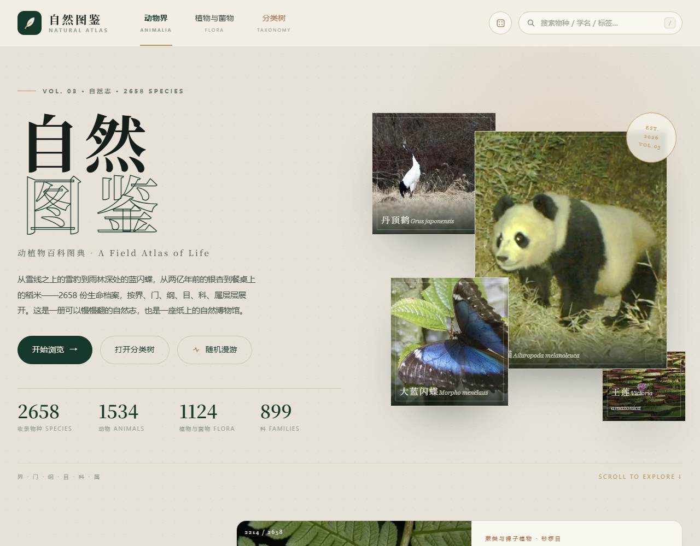

# 自然图鉴 · 动植物百科图典

一个**纯静态、可离线双击打开**的中文动植物百科网站。**2658 个物种**（动物 1534 种 / 植物与菌物 1124 种），按「界—门—纲—目—科—属」精细分类，每个物种都配有本地照片、分类地位、形态数据、详细科普与趣味知识。



> **v3.5（2026-11）**：按你的要求，**72 张占位图已全部补成图片**（不再筛选许可）。其中大部分来自 iNaturalist/GBIF 的物种照片；少数冷门物种（如部分真菌、寄生虫、栽培品种）使用标本照、显微照或同属参考图，并已在详情页注明“未核验许可，仅个人学习参考”。**这批图片版权归原作者，未经授权，不要公开商用或再发布。**
>
> **v3.4（2026-11）**：① 代表物种照片第二轮人工优选（雪豹、大猩猩、丹顶鹤、朱鹮、绿孔雀、白头海雕、雪鸮、大红鹳、帝企鹅、麋鹿、藏羚羊），统一改为主体突出、无人的手、本种照片；② 「生命之网」改为**以物种为中心的关系探索器**：左侧当前物种，右侧关系卡片，箭头/颜色说明，支持下拉选物种、随机切换、按类型筛选，比全站连线更易读。
>
> **v3.3（2026-11）**：① 新增 **「生命之网」生态关系网**：84 个物种、56 条关系（捕食/共生/寄生/竞争/传粉/传播/栖息），可按类型筛选、点击跳转，并在物种详情页展示关系；② 代表物种照片**人工优选**：精选与封面共 21 个物种（大熊猫、狮子、虎、丹顶鹤、朱鹮、蓝闪蝶、鲸鲨、科莫多巨蜥、红眼树蛙、椰子蟹、海月水母、莲花、桫椤、水稻等）换成主体居中、少人手的本种照片；③ 仍保留 72 张明确标注的占位图（无合法可用照片）。
>
> **v3.2（2026-10）**：① 物种扩编至 **2658**（+258）；② **照片质量提升**：对 202 张偏小/偏糊/构图差的图片，改用 iNaturalist 社区投票靠前的本种观测照片，替换 156 张；③ 新增**今日物种**、**分类星图**、**随机漫游**、精选左右翻页、顶部滚动进度与封面视差等创意交互；④ 保持「本种照片 + 合法许可」原则，全站无 ARR/ND/GFDL 图片。
>
> **v3.1**：图片许可合规整理（逐张显示作者、许可与原始链接）；**v3.0**：全站视觉重做，新增分类树与目级细分筛选。

## 快速开始

直接双击 **`index.html`**（或 `打开网站.bat`）即可在浏览器中浏览：无需服务器、无需联网、不收集任何数据。

## 功能

- **封面 & 策展**：超大宋体 Hero + 4 张代表物种拼贴；「分类总览」18 张图片卡片；深色「策展精选」横向画廊（支持左右翻页）收录 10 个代表物种。
- **今日物种**：每天按日期从精选物种中抽出一位主角，配大图与简介，点击直达详情（每天自动轮换）。
- **分类星图**：18 个类群按「圆面积 ∝ 物种数」铺成星座图，悬停辨认、点击进入对应类群。
- **随机漫游**：导航骰子按钮或首页「随机漫游」，随机打开一个物种详情，适合漫无目的地逛。
- **分类树**：按「界 → 门 → 纲 → 目 → 科」逐层展开、显示各分支物种数，点击任意层级即可筛选该分支下的全部物种（入口：导航「分类树」/ 首页按钮 / `#/tree`）。
- **细分筛选**：进入某类群后可再按「目」筛选（如哺乳动物 19 个目、昆虫多个目），筛选条件显示为可移除标签。
- **全站搜索**：中文名、别名、拉丁学名、标签、分类名实时匹配并高亮；支持 `?q=关键词` 深链（如 `index.html?q=鲸`）。
- **物种详情**：大图 + 界门纲目科属分类链 + 体型/食性/寿命/栖息/分布/保护级别数据表 + 两段物种志 + 3–5 条趣味知识 + 标签 + **图片作者、许可与原始链接** + 上下篇导航。
- **交互与性能**：图片懒加载（带骨架微光）、每批 96 个渐进加载、`/` 聚焦搜索、`Esc` 关闭、`←/→` 切换物种、回到顶部、滚动进度条、封面视差、滚动入场动画（尊重「减少动态效果」）、响应式（手机 / 平板 / 桌面）。
- **Hash 路由**：`#/animals`、`#/plants`、`#/category/mammals`、`#/species/mammal-giant-panda`、`#/tree` 均可直接访问。

## 目录结构

```
nature-encyclopedia/
├─ index.html                  页面骨架（Hero / 分类总览 / 精选 / 图录 / 分类树 / 详情弹层）
├─ css/style.css               全部样式（无外部字体 / CDN）
├─ js/data-core.js             物种注册表与图片路径工具
├─ js/app.js                   渲染、筛选、分类树、搜索、弹层、路由、动画、关系网
├─ js/image-credits.js         图片来源与许可（自动生成，逐条记录）
├─ data/meta.js                站点信息、18 个分类、策展精选、分类封面
├─ data/relations.js           生态关系数据（物种间捕食/共生/寄生等）
├─ data/animals/*.js           10 个动物分类（1534 种，昆虫分 5 个文件）
├─ data/plants/*.js            8 个植物/菌物分类（1124 种，真菌分 3 个文件）
├─ assets/images/              本地物种照片 + 2 张自绘占位图
├─ plan/species*.json          物种总表与扩编分表（id / 中文名 / 学名 / 分类 / 目标文件）
├─ plan/image-*.json           图片版权账本、抓取与许可整理报告
├─ scripts/fetch_images.py     图片抓取（两阶段：解析 + 并发下载）
├─ scripts/legalize_strict.py  许可清理（替换「保留所有权利 / ND」类图片）
├─ scripts/validate-data.mjs   数据契约校验（全量 / --cat / --file）
├─ scripts/qa-content.mjs      内容巡检（重复句、模板腔、标点、学名格式等）
├─ scripts/append_batch.py     数据分批追加工具（避免大文件整读）
└─ SPEC.md                     项目规范与数据契约
```

## 内容与数据

- **2658 个物种**：动物 1534（哺乳 220、鸟 209、爬行 105、两栖 84、鱼 137、昆虫 357、蛛形 68、甲壳 77、软体 122、其他无脊椎 155）；植物与菌物 1124（乔木 185、灌木花木 145、花卉草本 165、多肉 97、水生 87、蕨类裸子 88、农作物 144、真菌 213）。
- 每个物种字段：`id / name / latin / kingdom / category / aliases / taxonomy(门纲目科属) / summary / description（两段，约 260–450 字）/ habitat / distribution / conservation / details（5–8 项具体数据）/ facts（3–5 条）/ tags / featured`。
- 数据校验（需要 Node.js）：

  ```bash
  node scripts/validate-data.mjs              # 全量：字段、字数、分类数量、与 plan 一致性
  node scripts/validate-data.mjs --images     # 额外检查图片与版权登记
  node scripts/validate-data.mjs --file=01-trees.js   # 只校验某个数据文件
  node scripts/qa-content.mjs                 # 内容巡检：重复句、模板腔、半角标点等
  ```

## 图片与许可（重要）

- 全部照片来自 [iNaturalist](https://www.inaturalist.org) 公开 API；每张照片的作者、许可、原始页面记录在 `js/image-credits.js`，详情页展示并链接到许可全文。
- **本站为非商业性学习与科普展示**：CC BY / CC BY-SA / CC BY-NC / CC BY-NC-SA 等许可图片按其条款署名使用；其中 **NC（非商业）许可图片不得用于商业用途**。
- 已移除/替换 `all rights reserved`、`GFDL`、`CC BY-ND`、`CC BY-NC-ND` 等不允许演绎或不允许本站使用的图片（见 `plan/legalize-report.json`）；**每个物种只使用本种自己的照片，不使用同属近缘种照片代替**；当前 **2580 种为本种实拍照片**，仅 **78 种**因 iNaturalist 上没有任何可用合法许可照片，使用**本站自绘占位图**（图版上明确标注「示意占位图」）。
- **照片清晰度优化**：对 202 张偏小、偏糊或构图不佳的图片，改用「社区投票靠前 + 本种学名校验 + 合法许可过滤」的本种观测照片，成功替换 156 张；其余保留原图或占位图。
- **如需商业使用（广告、付费产品、周边、App 等）**：必须逐张核实许可，替换所有 NC / ND / ARR 图片，或自行取得授权；本站不对商用合规性作保证，本段不构成法律意见。
- 重新抓取 / 补齐图片（Python 3 + Pillow）：

  ```bash
  python scripts/fetch_images.py --phase all        # 补齐缺失（已存在跳过）
  python scripts/legalize_strict.py                 # 清理不可用许可图片
  ```

## 设计说明

- 配色：纸感米白 `#F5F1E8`、深林绿 `#16382A`、香槟金 `#B9975B`、墨色 `#141D18`。
- 字体：标题宋体/思源宋体衬线栈，正文苹方/微软雅黑，拉丁学名 Georgia 斜体；全部系统字体，离线可用。
- 版式：1320px 栅格；封面式 Hero、分类画廊、深色精选带、章节编号与细分割线；动效克制，支持 `prefers-reduced-motion`。

## 说明

- 文字内容据公开科普资料整理，由 AI 辅助编写，**未经专业分类学审订**；保护等级参考 IUCN 红色名录与中国重点保护名录，分类体系尽量采用较新观点，不同资料口径可能略有差异。
- 本站内容仅供学习参考，不作为科研、法律或保护决策依据；请勿据此采捕、交易受保护野生动植物。

— 自然图鉴 · 把整个自然，收进一册图鉴。

## 静态页、SEO 与部署（v3.6）

- `scripts/build_static.cjs` 会从 `data/*.js` 生成 **2658 个物种独立页**（`species/<id>.html`），每页包含：
  - 独立 `<title>`、`description`、`canonical`、Open Graph；
  - JSON-LD（Taxon + BreadcrumbList）；
  - 分类、栖息、分布、保护级别、物种志、形态数据、趣味知识、生态关系、上下篇导航。
- 同时生成：`species/index.html`（全部物种索引）、`search.html` + `search-index.js`（站内搜索，支持中文名/别名/学名/标签）、`sitemap.xml`、`robots.txt`、`.nojekyll`。
- 修改 `site.config.json` 的 `siteUrl` 后运行：

  ```bash
  node scripts/build_static.cjs
  ```

- **部署**：按 [DEPLOY.md](DEPLOY.md) 推到 GitHub，Settings → Pages → Source 选 “GitHub Actions”；工作流会自动重建并部署。
- **被搜索引擎搜到**：部署后把 `sitemap.xml` 提交到 Google Search Console、Bing Webmaster Tools、百度搜索资源平台；通常 1–4 周开始收录。
- 站内搜索为无依赖静态索引，本地双击也能用；如需 Pagefind，可执行 `npx pagefind --site .` 后替换 UI。

## 图片格式与体积（v3.6）

- 全站 2658 张图片已转为 **WebP**（quality 80，宽 ≤900），ssets/images 由约 266 MB 降到约 190 MB。
- 重新抓图后请运行：

  `ash
  python scripts/convert_to_webp.py
  `

  然后确认 scripts/validate-data.mjs 的图片检查通过（站点引用 .webp）。
- 当前仓库（含 Git 历史）约 250–300 MB，在 GitHub Pages 1 GB 限制内；首次推送会较慢。
